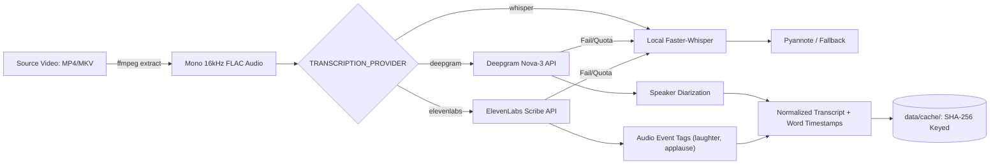
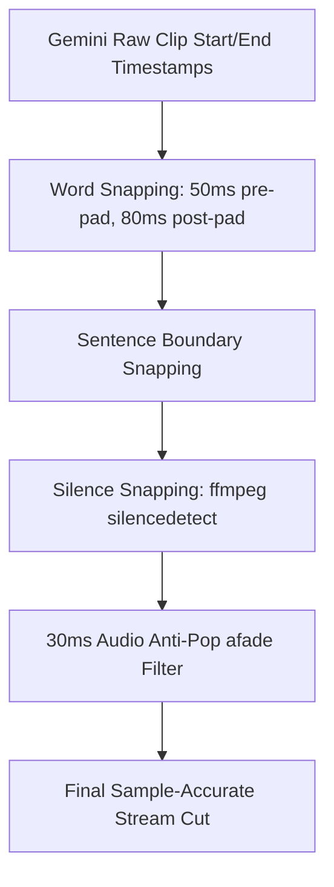
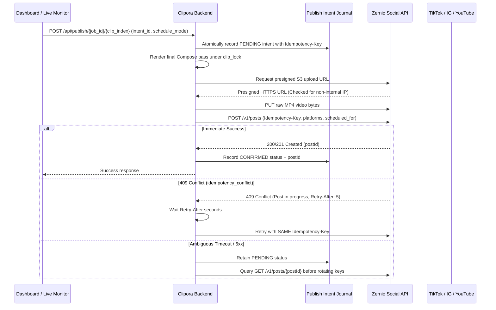

# CLIPORA: MASTER SYSTEM SPECIFICATION & AUTONOMOUS DEVELOPMENT PROMPT
> **Target Project Name**: Clipora  
> **Source Architecture Reference**: ClippyMe / OpenShorts Evolutionary Stack  
> **Role**: Principal Systems Architect, AI/Media Pipeline Engineer, Full-Stack Developer  
> **Mission**: Build, from ground zero to production deployment, **Clipora** — an enterprise-grade, self-hosted, fully autonomous AI video repurposing platform that converts long-form landscape video (YouTube, Twitch, Kick, and raw uploads) into engagement-optimized 9:16 vertical shorts with active-speaker framing, kinetic karaoke captions, silence removal, branding layers, and multi-platform social distribution.

---

## 1. EXECUTIVE PROMPT INSTRUCTION FOR AI AGENTS & CODING TEAMS

```text
You are tasked with engineering "Clipora" — a complete, production-grade, self-hosted AI video clipping, reframing, and publishing engine.

You must build this entire system adhering strictly to the architecture, pipeline stages, safety invariants, computer vision math, prompt engineering protocols, and UI specifications defined in this master blueprint.

Do not simplify or cut corners. Every component — from the process-isolated job orchestrator, the 5-axis virality evaluator, the asymmetric cut-boundary snapper, and the multi-layer on-demand FFmpeg compose engine, to the 24/7 stream monitor and React dashboard — must be implemented with production rigor.
```

---

## 2. HIGH-LEVEL ARCHITECTURE & CORE DESIGN PATTERNS

```mermaid
flowchart TD
    subgraph UI ["Frontend (React 18 + Vite + Tailwind CSS)"]
        Dash[Dashboard UI]
        CreateTab[Create & Batch Intake]
        ProcTab[Telemetry & Process Control]
        ResGrid[Results & Video Preview]
        ClipMod[Clip Editor Modal]
        LiveMon[Live Monitor Hub]
        HistTab[History & Restore]
        SettTab[Settings & Credential Vault]
    end

    subgraph API ["FastAPI Gateway (Port 8000)"]
        Sec[Security & SSRF Shield]
        RateLim[Token Bucket Rate Limiter]
        Routes[API Handlers]
        StaticMnt[Safe Static Mounts: /videos, /thumbnails, /fonts]
    end

    subgraph Core ["Engine Core & Services"]
        Q[In-Memory Async Job Queue]
        Journal[Job Journal: data/jobs_journal.json]
        LiveReg[Live Monitor Registry: Kick, Twitch, YouTube]
        PubEngine[Social Publishing Engine: Zernio Gateway]
        Locks[Asyncio & Threading Lock Hierarchy]
    end

    subgraph PipelineSubproc ["Subprocess Boundary (python -m clipora.pipeline.orchestrator)"]
        Orch[Pipeline Orchestrator]
        Preflight[Preflight Cost & Disk Gate]
        Downloader[yt-dlp Multi-Client Downloader]
        ASR[Audio Extraction & Transcription]
        GeminiGate[Gemini Virality & Copy Engine]
        Snapper[Word, Sentence & Silence Snapper]
        ReframeEng[PySceneDetect + YOLOv8 + MediaPipe 9:16 Reframe]
        PostProc[EBU R128 Audio + Ken Burns + Output QA]
    end

    subgraph OnDemand ["On-Demand Compose Engine"]
        Comp[Grade -> Subtitles -> Smart Cut -> Hook -> Logo -> Banner]
    end

    subgraph Storage ["Durable Filesystem Persistence"]
        DataDir[(data/: config.json, cache/, cookies.txt, fonts/)]
        OutputDir[(output/<job_id>/: clips, metadata, source slices, checkpoints)]
        UploadDir[(uploads/: local source videos)]
    end

    Dash -->|REST /api JSON| Sec
    Sec --> RateLim --> Routes
    Routes --> Q
    Routes --> Comp
    Routes --> PubEngine
    LiveReg --> Q
    Q --> Orch
    Orch --> Storage
    Comp --> OutputDir
    OutputDir --> StaticMnt --> Dash
    PubEngine -->|Presign + Upload + Post| ZernioAPI[Zernio Social API]
```



### 2.1 The 4 Architectural Tenets (Non-Negotiable Invariants)

1. **Subprocess Process Boundary**:
   - Heavy Computer Vision (OpenCV, PyTorch, MediaPipe, Ultralytics YOLOv8) and long-running video pipelines **must never run inside the FastAPI event loop or API thread pool**.
   - Every processing job spawns a dedicated operating system subprocess: `python -m clipora.pipeline.orchestrator`.
   - A segmentation fault, CUDA out-of-memory error, or native library crash in the CV pipeline cannot terminate the HTTP API.
   - Long jobs can be paused (`SIGSTOP` / `psutil.suspend()`), resumed (`SIGCONT` / `psutil.resume()`), or killed cleanly with their entire process tree.

2. **Heavy vs. Pure Host-Testable Separation**:
   - Files importing native CV/ML frameworks (`cv2`, `torch`, `mediapipe`, `ultralytics`, `scenedetect`) must be isolated strictly inside dedicated pipeline execution modules (`reframe.py`, `reframe_detect.py`, `main.py`).
   - All business logic, mathematical decision trees, trajectory filtering, prompt building, cut snapping, timecode math, and API services must live in **pure Python modules** (`cut_ops.py`, `reframe_ops.py`, `reframe_track.py`, `gemini_request.py`, `smartcut_ops.py`, `media_probe.py`).
   - The entire pure suite can be executed with `pytest -m "not integration"` in milliseconds on any developer machine without GPU drivers or heavy dependencies.

3. **Zero-Database Filesystem State & Crash Recovery**:
   - Clipora uses **no external SQL/NoSQL database**. The filesystem is the single source of truth.
   - All state mutations use **atomic writes**: create a unique temporary file (`tempfile.mkstemp(prefix=".tmp-", dir=...)`), serialize data, call `os.flush()`, `os.fsync()`, set permissions to `0o600`, and atomically commit via `os.replace()`.
   - Durable Job Journal (`data/jobs_journal.json`): Tracks currently running jobs. Rewritten atomically on every job state change. Survives power cuts and host reboots.
   - On application startup, the FastAPI `lifespan` handler scans the journal, re-enqueues queued jobs, reconnects completed job artifacts, inspects checkpointed jobs for resumption, and marks dead unrecoverable runs as `failed`.

4. **Strict Lock Ordering Hierarchy (Deadlock Prevention)**:
   - When coordinating multi-layer operations (reframe, smart cut, compose, publish), locks must **strictly** be acquired in this order and released in reverse:
     1. `clip_locks.clip_lock(job_dir, clip_index)`: Asyncio re-entrant lock guarding all operations on a specific physical clip.
     2. `smartcut._clip_lock` (Threading lock inside worker threads) OR Live Monitor's global `_publish_lock` (Asyncio lock serializing automated publish slots).
     3. `job_artifacts._METADATA_LOCK`: Innermost threading lock guarding reads/writes to `<job_id>_metadata.json`. Never hold a threading lock across an `await`.

---

## 3. FULL SUBSYSTEM BREAKDOWN & TECHNICAL IMPLEMENTATION

### 3.1 Subsystem 1: Ingestion & Media Probing

- **URL Ingestion**:
  - Accepts YouTube (standard videos, streams, VODs), Twitch clips/VODs, and Kick streams.
  - Multi-client player fallback for `yt-dlp`: `default -> tv+tv_embedded -> web_safari`. If YouTube returns a 403 or format throttling, fallback automatically moves down the chain.
  - Cookie Authentication: Supports Netscape-formatted `data/cookies.txt` uploaded via Settings to bypass YouTube bot blocks and age restrictions.
  - Direct Video Uploads: Supports multi-gigabyte local file uploads (`POST /api/upload`) streamed directly into `uploads/` with UUID-based filenames and `0o600` permissions.
- **SSRF & Security Shield (`core/netutil.py`)**:
  - Any user-supplied URL undergoes pre-flight host validation.
  - Resolves target host DNS and blocks loopback (`127.0.0.0/8`), private RFC1918 (`10.0.0.0/8`, `172.16.0.0/12`, `192.168.0.0/16`), link-local (`169.254.0.0/16`), multicast, and AWS/Cloud metadata IPs (`169.254.169.254`).
  - Authoritative re-check occurs immediately prior to network execution in `download.py` to prevent DNS rebinding attacks.

### 3.2 Subsystem 2: Audio Extraction & Multi-Provider ASR



- **Audio Extraction**:
  - Video is never sent to cloud speech APIs. FFmpeg extracts audio into 16 kHz mono FLAC:
    ```bash
    ffmpeg -y -i input.mp4 -vn -ar 16000 -ac 1 -c:a flac output_audio.flac
    ```
- **Provider Architecture**:
  1. **Deepgram (Default)**:
     - Uses Nova-3 REST API with `language="multi"` to enable automatic English/Italian/Spanish code-switching.
     - Built-in speaker diarization (`diarize=true`), punctuation (`smart_format=true`), and custom keyword biasing (`keyterms`).
  2. **ElevenLabs Scribe**:
     - Scribe v1/v2 API. Generates rich non-speech audio cues (`(laughter)`, `(applause)`, `(cheering)`).
     - Optional audio isolation pass (`AUDIO_ISOLATION=true`) running ElevenLabs Voice Isolator to remove background music or game noise prior to ASR.
  3. **Faster-Whisper (Local Fallback)**:
     - Runs completely offline using CTranslate2.
     - Hardware-adaptive model selection:
       - CUDA VRAM $\ge 6\text{ GB}$: `large-v3` (float16).
       - CUDA VRAM $\ge 3\text{ GB}$: `medium` (float16).
       - CUDA VRAM $< 3\text{ GB}$: `small` (float16).
       - CPU Host RAM $\ge 16\text{ GB}$: `medium` (int8).
       - CPU Host RAM $\ge 8\text{ GB}$: `small` (int8).
       - CPU Low Resource: `base` (int8).
- **Graceful Cloud Fallback**:
  - If Deepgram or ElevenLabs fails (network drop, invalid API key, quota exceeded), the system automatically catches the error, logs a warning, and executes local Faster-Whisper. The job never crashes due to an ASR provider outage.
- **Caching**:
  - Transcripts are cached under `data/cache/<sha256(source_url)>.json` with a 7-day TTL to avoid re-transcribing recurring content.

### 3.3 Subsystem 3: AI Viral Detection & Prompt Engineering (Gemini)

- **TOON (Token-Oriented Object Notation) Compression**:
  - Sending raw JSON word lists burns thousands of useless tokens on repetitive dictionary keys (`{"word": "...", "start": 12.3, "end": 12.8}`).
  - Clipora compiles the word list into TOON tabular format, saving up to 65% of input tokens:
    ```text
    words[425]{w,s,e}:
      Hello,0.120,0.450
      world,0.480,0.890
      "quote, mark",0.920,1.350
    ```
- **The 4-Tier Virality Gate (Pre-Scoring Filter)**:
  Before scoring, candidate clips must pass at least ONE gate:
  1. *Unexpected Turn*: Pattern interrupt, contradiction, twist, or reveal.
  2. *Strong Emotion / Polarization*: Instant laugh, outrage, secondhand embarrassment, or a divisive take that forces viewers to take sides in the comments.
  3. *Relatability*: "This is literally me" — specific, everyday observations.
  4. *New or Useful Information*: A concrete fact, hack, number, or debunked misconception that viewers save.
- **The 5-Axis Scoring Rubric (1–100 Scale, 20 pts per axis)**:
  - `HOOK_STRENGTH` (1–20): Attention grab in the first 1–3 seconds.
  - `EMOTIONAL_PAYOFF` (1–20): Quality of the reaction beat, punchline, or twist.
  - `QUOTABILITY` (1–20): Memorability of lines viewers will quote or debate.
  - `SELF_CONTAINED` (1–20): Understandable without watching the full 2-hour video.
  - `DENSITY` (1–20): Pacing, zero dead air, high informational/entertainment value per second.
- **Copywriting Engine Rules**:
  - Titles must not summarize; they must drive engagement.
  - *Speculate Out Loud*: Exaggerate the stakes, use conditional consequences, and provoke comment debate ("Did he just ruin his career?", "Is this coin actually worth $10k?").
  - *Hard Anti-Clickbait Rule*: Never invent untrue facts about real people or medical/financial news. Exaggerate framing, never invent events.
  - *Stack Two Triggers*: Pair an open loop with a stakes callout or prediction bait.
  - *Conversational Openers*: Descriptions must end with open questions or debatable claims ("Would you sell this?", "Tell me I'm wrong"). Never use banned mechanical CTAs like "Comment X for link".
- **5-Level Robust JSON Parsing & Repair Pipeline (`gemini_parser.py`)**:
  1. *Strict Parse*: Read everything after the literal delimiter `### JSON ###`.
  2. *Deterministic Cleanup*: Regex removal of code fences (` ```json `), smart/curly quotes normalization, trailing comma stripping (`,\s*[}\]]`), and lone backslash fixes.
  3. *Library Repair*: Invocation of `json_repair.loads()`.
  4. *Targeted LLM Reformat*: Fast roundtrip to `gemini-2.5-flash` passing the malformed text and JSON decode error with an instruction to emit pure JSON only.
  5. *TextTiling Fallback*: If all parsing fails, execute lexical TextTiling topic segmentation to produce unranked candidate clips rather than failing the job.

### 3.4 Subsystem 4: Micro-Precision Cut Boundary Snapping



- **Word Boundary Snapping (`cut_ops.snap_clip_to_words`)**:
  - ASR timestamps drift by 50–100ms. If an LLM returns `start=12.4`, cutting at 12.4s often truncates the opening consonant.
  - Snaps `start` to the nearest word start timestamp within a 0.6s window, then subtracts a `50ms` lead pad.
  - Snaps `end` to the nearest word end timestamp, then adds an `80ms` release pad.
- **Sentence Boundary Snapping (`cut_ops.snap_to_sentences`)**:
  - Prevents mid-sentence truncation. Inspects punctuation on word tokens (`.`, `!`, `?`, `…`).
  - *Asymmetric Budget*: Allows `start` to move backward up to `2.5s` to catch the opening of a thought; allows `end` to extend forward up to `1.5s` (tightly bounded to avoid exceeding maximum short duration or overlapping neighboring clips).
  - *Abbreviation Shield*: Rejects false sentence breaks caused by tokens like `Dr.`, `Mr.`, `vs.`, `e.g.`, `dott.`, `inc.`.
- **Silence Boundary Snapping (`cut_ops.snap_to_silences`)**:
  - Runs FFmpeg `silencedetect=noise=-30dB:d=0.25` around clip boundaries.
  - If a silence pocket exists within 0.75s of the cut point, snaps the cut cleanly inside the silence interval.
- **Anti-Pop Audio Fades**:
  - Applies a 30ms linear fade-in and fade-out at every cut seam to eliminate audible speaker clicks:
    ```text
    afade=t=in:st=0:d=0.03,afade=t=out:st=<dur-0.03>:d=0.03
    ```

### 3.5 Subsystem 5: Intelligent 9:16 Vertical Reframing

- **3 Reframing Modes**:
  1. `auto` (Default): Active speaker tracking combined with scene-level static framing.
  2. `subject`: FrameShift-style multi-class weighted interest tracking (Face: 1.0, Person: 0.8, Objects: 0.5).
  3. `disabled`: Full landscape frame letterboxed between black bars with optional zoom (5–15%).
- **PySceneDetect & 7-Frame Scene Sampling**:
  - Splits source video into distinct shots using `ContentDetector(threshold=27.0)`.
  - For each scene, extracts 7 distributed frames to classify shot type:
    - `TRACK`: One static speaker detected -> Lock camera crop tightly on face.
    - `WIDE`: Two or more faces detected, or speaker moves $>12\%$ of frame width -> Lock camera on wide group crop.
    - `GENERAL`: No faces detected -> Center crop, Sobel saliency crop, or weighted object centroid.
- **Anti-Seasickness Camera Policy ("Tripod Mode")**:
  - *Problem*: Continuous per-frame bounding-box tracking produces jerky, nausea-inducing camera movements.
  - *Rule*: **The camera never moves within a shot**.
  - `REFRAME_STATIC_AUTO=1`: Collapses all frame detections across a scene into a single, optimal, fixed crop coordinate. The camera functions as a locked tripod. Zoom and position change *only* at cut boundaries.
  - *Smooth Tracking Fallback (`REFRAME_STATIC_AUTO=0`)*: Uses a 1€ adaptive filter (`OneEuroFilter`) with velocity clamping and dead zones to smooth panning. If a speaker is lost for $>90$ frames (`REFRAME_LOST_HOLD`), the camera drifts slowly back to center over $0.05$ lerp increments.

### 3.6 Subsystem 6: On-Demand Dynamic Compose Engine

When a user downloads, previews, or publishes a clip, Clipora renders edit layers dynamically from the pristine source slice (`source_<clip>.mp4`).

**Strict Processing Order**:
$$\text{Grade} \longrightarrow \text{Subtitles} \longrightarrow \text{Smart Cut} \longrightarrow \text{Hook Overlay} \longrightarrow \text{Logo Watermark} \longrightarrow \text{Attribution Banner}$$

```text
1. Grade:
   Presets: warm_cinematic, cool_crisp, neutral_punch, vivid_pop. Applied first so overlay graphics retain their exact hex colors.

2. Subtitles:
   - 6 Animated ASS Karaoke Presets: classic_white, hormozi_bold, neon_cyan, red_punch, minimal_dark, pastel_pop.
   - Word-level highlighting using libass {\k<duration>} tags.
   - Smart line wrapping with semantic boundary breaks.
   - Automatic font discovery: SFNT parser extracts TrueType name ID 4 (Full Name) to guarantee libass finds bundled and user-uploaded fonts.

3. Smart Cut:
   - Removes silences (>0.8s default, keeping 0.3s cushion) and filler words (um, uh, like, cioè, tipo).
   - Driven by compiled Auto-Editor v3 timeline JSON or FFmpeg concat demuxer.
   - Secondary audio threshold polish pass prescreened by a silence probe.
   - Natural Language AI Trimming (/api/edit-ai): Translates instructions ("cut the first 5 seconds", "remove where he stumbles") into drop ranges.

4. Hook Overlay:
   - Dynamic 3-8 word curiosity-gap title banner rendered using Pillow.
   - Supports custom fonts, outline width, background box opacity, and emojis.
   - Animated entry with fade/bounce; requires FFmpeg -loop 1 and -shortest to avoid rendering frozen blank frames.

5. Logo Watermark:
   - Uploaded PNG watermark placed in 1 of 6 positions (top-left, top-right, bottom-left, bottom-right, center-top, center-bottom) with size S/M/L, opacity, and margin controls.

6. Attribution Banner:
   - Bottom/top attribution card displaying platform SVG logo (Kick, Twitch, YouTube) + creator channel handle.
```

### 3.7 Subsystem 7: 24/7 Autonomous Live Stream & VOD Monitor

- **Continuous Channel Monitoring**:
  - Background worker watching creator channels across **Kick**, **Twitch**, and **YouTube RSS**.
  - Kick streams are polled using `curl-cffi` with TLS/JA3 fingerprint impersonation to bypass Cloudflare anti-bot barriers.
  - Twitch monitors authenticate with Twitch Helix API app credentials.
  - YouTube monitors follow channel RSS feeds to detect new uploads instantly.
- **Prelive Waiting Screen Skip**:
  - Automatically skips the first $N$ minutes (default 30 min) of a stream to bypass "Starting Soon" countdowns.
- **Segment Slicing & Auto-Queue**:
  - Active live streams are captured into fixed time slices (e.g. 30-minute segments) via streamcopy.
  - Segments are submitted as regular jobs to the in-memory queue.
- **Catchup & Backfill**:
  - On launch, `catchup="backfill"` downloads and processes missed stream content (Twitch archive VOD range download; Kick replay processing upon stream end).
- **Automated Viral Curation & Publishing**:
  - `clip_selection="auto"`: Only clips exceeding `min_viral_score` (default 70) are kept. Weak segments yield zero clips rather than polluting social channels.
  - Hands-free pipeline: Automatically composes clips with branding, schedules posts spaced by `min_gap_seconds` (default 15–90 min), and purges raw video files after verified publication.

### 3.8 Subsystem 8: Social Publishing & Idempotent Scheduling (Zernio)



- **SmartScheduler Prime-Time Algorithm**:
  - Modes: `now`, `manual` (explicit ISO 8601 instant with timezone awareness), `auto`.
  - `auto` calculates the creator's peak engagement windows for the target platform (e.g. 18:00–21:00 weekday evenings), scanning for the first open slot with at least `ZERNIO_MIN_GAP_SECONDS` (90 min) clearance from existing posts.
  - In batch mode, each subsequent clip begins its slot search 24 hours later to distribute content across the week.
- **Idempotency & The 3 Distinct Identities**:
  - `(job_id, original_index)`: The immutable logical clip coordinate.
  - `publication_id`: The persistent monitor publication entity.
  - `request_id`: The provider `Idempotency-Key`. Reused across all retries of ambiguous network drops. Never rotated until a definitive rejection is acknowledged.

---

## 4. COMPLETE PROJECT REPOSITORY LAYOUT

```text
clipora/
├── .env.example                     # Reference environment variables
├── .dockerignore
├── .gitignore
├── pyproject.toml                   # Project metadata & host test dependencies
├── requirements.txt                 # Full CV/ML runtime dependencies
├── requirements.lock                # Deterministic uv lockfile
├── Dockerfile                       # Multi-stage production container
├── docker-compose.yml               # Standard CPU / ARM container compose
├── docker-compose.gpu.yml           # NVIDIA CUDA runtime overlay
├── data/                            # Persistent state directory (git-ignored)
│   ├── config.json                  # API keys and user preferences
│   ├── jobs_journal.json            # Active crash recovery journal
│   ├── live_monitor.json            # Active stream monitor states
│   ├── cookies.txt                  # Uploaded YouTube session cookies
│   ├── logo.png                     # Uploaded brand watermark
│   ├── fonts/                       # User-uploaded TTF/OTF fonts
│   └── cache/                       # 7-day transcript cache
├── fonts/                           # Bundled open-source display fonts
├── uploads/                         # Temporary uploaded video storage
├── output/                          # Rendered job artifacts (<job_id>/)
├── src/
│   └── clipora/
│       ├── __init__.py
│       ├── api/                     # Thin FastAPI HTTP Layer
│       │   ├── app.py               # Main router & middleware
│       │   ├── config_routes.py     # Settings & credential endpoints
│       │   ├── schemas.py           # Pydantic request & response models
│       │   └── security.py          # Origin checks, token auth, rate limiter
│       ├── core/                    # Neutral core primitives
│       │   ├── clip_schema.py       # ViralClip & response models
│       │   ├── errors.py            # CliporaError domain exception hierarchy
│       │   └── netutil.py           # SSRF-safe DNS resolution utilities
│       ├── media/                   # Pure FFmpeg / FFprobe primitives
│       │   ├── encode.py            # Unified libx264 encoding arguments
│       │   ├── ffmpeg_exec.py       # Atomic ffmpeg runner with watchdog
│       │   └── media_probe.py       # ffprobe metadata inspectors
│       ├── jobs/                    # Job lifecycle management
│       │   ├── job_artifacts.py     # Metadata read/write with atomic file locks
│       │   ├── job_control.py       # Pause, resume, stop, cancel controllers
│       │   ├── job_journal.py       # Durable startup recovery journal
│       │   ├── job_results.py       # Command builders & language maps
│       │   ├── job_runner.py        # Subprocess execution & output polling
│       │   ├── job_submission.py    # Queue dispatch & validation
│       │   └── runtime_state.py     # Durable phase & attempt tracking
│       ├── clips/                   # Per-clip business logic
│       │   ├── clip_locks.py        # Re-entrant per-clip asyncio locks
│       │   ├── clip_resolve.py      # Artifact resolution & path builders
│       │   ├── reframe_service.py   # On-demand reframe dispatch
│       │   └── smartcut_service.py  # On-demand silence cut dispatch
│       ├── editing/                 # Video compose layers
│       │   ├── banner.py            # Attribution card rasterizer
│       │   ├── clip_edit_ai.py      # Natural language instruction parser
│       │   ├── compose.py           # Multi-pass filter graph compositor
│       │   ├── grade.py             # Color grading preset matrices
│       │   ├── hook_overlay.py      # Pillow graphic generator & animations
│       │   ├── logo.py              # Brand watermark overlay placement
│       │   ├── smartcut.py          # Auto-Editor & FFmpeg cut orchestrator
│       │   ├── smartcut_ops.py      # Pure silence & filler detection math
│       │   └── subtitles.py         # ASS karaoke & SRT generator
│       ├── monitoring/              # 24/7 automated stream monitors
│       │   └── live_monitor.py      # LiveMonitorRegistry & platform strategies
│       ├── publishing/              # Social media distribution
│       │   ├── intent_journal.py    # Idempotent publishing state machine
│       │   └── publish_service.py   # Zernio publishing coordinator
│       ├── integrations/            # External platform client SDKs
│       │   ├── auto_editor_updater.py
│       │   ├── kick_client.py       # curl-cffi Kick stream scraper
│       │   ├── social_publisher.py  # Zernio REST client & smart scheduler
│       │   ├── twitch_client.py     # Twitch Helix API client
│       │   └── youtube_client.py    # YouTube RSS parser
│       ├── pipeline/                # Subprocess pipeline package
│       │   ├── orchestrator.py      # Subprocess entrypoint & checkpoints
│       │   ├── main.py              # Heavy CV execution pipeline
│       │   ├── download.py          # yt-dlp downloader with retry chain
│       │   ├── cut_ops.py           # Word, sentence & silence snapping math
│       │   ├── hardware.py          # CPU/GPU probe & Whisper model picker
│       │   ├── postprocess.py       # Loudness normalization & Ken Burns
│       │   ├── preflight.py         # Conservative cost & disk estimator
│       │   ├── run_ops.py           # Path sanitization & filename utilities
│       │   ├── analysis/            # AI viral moment scoring
│       │   │   ├── gemini_parser.py # 5-level JSON repair parser
│       │   │   ├── gemini_request.py# TOON encoder & prompt templates
│       │   │   ├── gemini_service.py# Google GenAI client caller
│       │   │   └── texttiling_ops.py# Heuristic fallback segmentation
│       │   ├── quality/             # Output QA validation
│       │   │   ├── clip_qa.py       # Quality score calculations
│       │   │   ├── media_qa.py      # FFprobe black/freeze frame inspectors
│       │   │   └── quality_suite.py # Regression QA suite
│       │   ├── reframe/             # 9:16 Vertical reframing
│       │   │   ├── reframe.py       # Render loops & video writers
│       │   │   ├── reframe_detect.py# YOLOv8 & MediaPipe detectors
│       │   │   ├── reframe_ops.py   # Tripod math & 1€ filter math
│       │   │   ├── reframe_track.py # SpeakerTracker & Cameraman
│       │   │   └── scene_detection.py # PySceneDetect scene splitter
│       │   └── transcription/       # ASR implementations
│       │       ├── deepgram_transcribe.py
│       │       ├── elevenlabs_transcribe.py
│       │       ├── diarization.py
│       │       └── transcribe_cache.py
│       └── storage/
│           └── config_store.py      # Atomic JSON configuration loader
├── dashboard/                       # React 18 + Vite Frontend
│   ├── package.json
│   ├── vite.config.js
│   ├── tailwind.config.js
│   ├── src/
│   │   ├── main.jsx
│   │   ├── app/
│   │   │   ├── App.jsx              # Tab navigation & global state wiring
│   │   │   └── AppErrorBoundary.jsx # UI crash container
│   │   ├── api/                     # Backend API client
│   │   ├── components/              # Shared UI design system
│   │   │   ├── primitives.jsx       # Hand-rolled accessible UI elements
│   │   │   ├── LazyVideo.jsx        # IntersectionObserver video player
│   │   │   └── controls/            # Shared editing controls
│   │   │       ├── subtitleControls.jsx
│   │   │       ├── layerControls.jsx
│   │   │       ├── hookStyle.jsx
│   │   │       └── bannerControls.jsx
│   │   ├── features/                # Domain feature views
│   │   │   ├── create/              # Single & batch job intake
│   │   │   ├── processing/          # Live telemetry, logs & controls
│   │   │   ├── results/             # Short-form video grid & previews
│   │   │   ├── clip-editor/         # Modal with 7 editing tabs
│   │   │   ├── live-monitor/        # Automated channel monitors
│   │   │   ├── publishing/          # Social platform scheduling modal
│   │   │   ├── history/             # Past job search, restore & delete
│   │   │   └── settings/            # Credential vault & font uploads
│   │   ├── hooks/                   # Custom React hooks
│   │   └── lib/                     # Pure client-side utilities
│   │       ├── constants.js
│   │       └── uiOptions.js         # Preset tables matching backend
└── tests/                           # Complete test suite
    ├── api/                         # FastAPI route tests
    ├── clips/                       # Clip resolution & lock tests
    ├── editing/                     # Compose, grade, subtitle tests
    ├── jobs/                        # Queue, control & journal tests
    ├── pipeline/                    # Pure math, snapping & parser tests
    └── integrations/                # Zernio contract & scraper tests
```

---

## 5. ESSENTIAL CONSTANTS, SCHEMAS & TEMPLATES

### 5.1 The Canonical Gemini Virality Prompt Template

```python
GEMINI_PROMPT_TEMPLATE = """
You are a senior short-form video editor specialized in TikTok, IG Reels and YouTube Shorts virality. Read the ENTIRE transcript + word-level timestamps and select the 3–15 MOST VIRAL 15–60s moments.

## IS THIS MOMENT EVEN WORTH CUTTING? (gate — apply BEFORE scoring)
A clip must hit at least ONE of these HARD. A moment that is merely pleasant, well-spoken or on-topic is NOT a clip, however clean the audio is.
1. UNEXPECTED TURN — plot twist, pattern interrupt, someone contradicting what they just said, a reveal nobody saw coming. The surprise is the product.
2. STRONG EMOTION OR POLARIZATION — instant laugh, rage, awe, secondhand embarrassment; or a take that splits the audience in two. The test: would a viewer send this to a friend or drop it in a group chat? A moment half the audience wants to argue with outperforms one everybody agrees with.
3. RELATABILITY — "this is literally me". Specific and everyday, not abstract.
4. NEW OR USEFUL INFO — a fact, number, trick or broken misconception a viewer would SAVE for later.
Emit FEWER, harder clips rather than padding the list with competent-but-flat moments: a weak clip costs the account more than a missing one.
The reaction beat is PART of the clip — the laugh, the silence after the reveal, the "what?!". End after it lands, never before.

## VIRAL_SCORE RUBRIC (1–100)
Score each axis from 1 to 20 and sum (cap at 100):
- HOOK_STRENGTH: do the first 1–3s grab attention? (pattern-break, bold claim, surprise). Roughly half of viewers swipe before 3s — a slow ramp is fatal.
- EMOTIONAL_PAYOFF: is there an actual turn or reaction — shock, laugh, rage, awe — and does it LAND on screen? Score the surprise and reaction, not the subject matter.
- QUOTABILITY: is there a line viewers would screenshot, repeat, or argue with?
- SELF_CONTAINED: makes sense without context from the rest of the video?
- DENSITY: no dead air, no rambling, every second earns its place. Silence and tangents are the top retention killer.

## HARD CONSTRAINTS (violating = clip REJECTED)
- 15s <= duration <= 60s
- start on a complete sentence boundary; end on a natural beat
- no cold-open ambiguity ("...and then she said" with no setup)
- 0 <= start < end <= VIDEO_DURATION_SECONDS
- ANCHOR TO REAL TIMESTAMPS: `start` MUST equal the `s` of the FIRST word in the WORDS section, and `end` MUST equal the `e` of the LAST word. Do not invent times between words; do not round to integers.
- start and end are FLOAT SECONDS with up to 3 decimals (e.g. 12.340, 1517.724). NEVER emit colon or dotted timecodes like "25:17" or "25.17.724".
- viral_reason MUST be >= 20 characters and cite the specific hook, payoff or quote.
- viral_hook_text is REQUIRED (3-8 words), written AS A SCROLL-STOPPING OVERLAY — NOT a transcript quote. Standalone copywriting designed to stop scrolling on TikTok/Reels.

## TITLE & CAPTION COPY
A title is NOT a summary of the clip. It is bait: its only job is to make someone stop, watch, and COMMENT.
1. PLAY UP THE STAKES. Frame what happens at its most dramatic, absurd, or consequential reading.
2. SPECULATE OUT LOUD. Allowed ONLY as open speculation using conditionals or questions ("Did he just ruin his stream?", "With this move he might retire"). Never invent false statements of fact.
3. BAIT COMMENTS IMPLICITLY. Give viewers something to reply to: an opinion that splits the room, a debatable valuation, a genuine question ("Tell me I'm wrong"). NEVER use mechanical engagement bait ("comment X for link", "like if you agree").
4. LEAVE THE LOOP OPEN. Name the object or reaction, never the outcome — the payoff must be watched.
5. CONCRETE > VAGUE. Use real numbers and specific objects.
6. STACK EXACTLY TWO triggers per title.

## VIDEO METADATA
VIDEO_DURATION_SECONDS: {video_duration}
{creator_block}

TRANSCRIPT_TEXT:
{transcript_text}

WORDS (TOON tabular format):
{words_toon}

{user_instructions_block}

## OUTPUT CONTRACT
1. Think step-by-step internally about candidate moments.
2. On its own line, emit the LITERAL delimiter:
### JSON ###
3. Emit ONLY the JSON object conforming to the schema:
{{
  "clips": [
    {{
      "start": 12.340,
      "end": 45.670,
      "viral_score": 92,
      "viral_reason": "Opens with immediate disbelief, builds tension with two failed attempts, and lands a high-energy punchline.",
      "viral_hook_text": "The one mistake everyone makes",
      "video_title_for_youtube_short": "Did he actually just lose 10,000 dollars live?",
      "video_description_for_tiktok": "He really thought he had it. Would you have taken the risk?",
      "video_description_for_instagram": "Watch until the end. Tell me you wouldn't have done the exact same thing."
    }}
  ]
}}
"""
```

### 5.2 Core Data Schemas (Pydantic v2)

```python
from pydantic import BaseModel, Field, field_validator
from typing import List, Optional

class ViralClip(BaseModel):
    start: float = Field(..., ge=0)
    end: float = Field(..., gt=0)
    viral_score: int = Field(..., ge=1, le=100)
    viral_reason: str = Field(..., min_length=20)
    viral_hook_text: str = Field(..., min_length=3, max_length=160)
    video_title_for_youtube_short: str = Field("", max_length=110)
    video_description_for_tiktok: str = Field("", max_length=2200)
    video_description_for_instagram: str = Field("", max_length=2200)

    @field_validator("start", "end", mode="before")
    @classmethod
    def normalize_timestamp(cls, v):
        if isinstance(v, str):
            v = v.strip()
            if ":" in v:
                parts = v.split(":")
                if len(parts) == 2: return float(parts[0]) * 60 + float(parts[1])
                if len(parts) == 3: return float(parts[0]) * 3600 + float(parts[1]) * 60 + float(parts[2])
            if v.count(".") > 1:
                parts = v.split(".")
                if len(parts) == 3: return float(parts[0]) * 60 + float(parts[1]) + float(f"0.{parts[2]}")
                if len(parts) == 4: return float(parts[0]) * 3600 + float(parts[1]) * 60 + float(parts[2]) + float(f"0.{parts[3]}")
        return float(v)

class ViralClipsResponse(BaseModel):
    clips: List[ViralClip]
```

### 5.3 Unified Media Encoding Arguments (`media/encode.py`)

```python
def x264_video_args(crf: int = 18, preset: str = "medium") -> list[str]:
    """Canonical libx264 encoding recipe across all Clipora rendering passes."""
    return [
        "-c:v", "libx264",
        "-crf", str(crf),
        "-preset", preset,
        "-pix_fmt", "yuv420p",
        "-movflags", "+faststart",
        "-threads", "0",
    ]
```

---

## 6. STEP-BY-STEP IMPLEMENTATION ROADMAP

Execute development in these 9 phased milestones:

```text
+---------------------------------------------------------------------------------------+
| PHASE 1: Storage, Primitives & In-Memory Async Job Queue                              |
| - Implement atomic JSON writes (0o600, temp file, fsync, os.replace).                 |
| - Implement core errors, SSRF-safe DNS resolution, and jobs_journal.json manager.     |
| - Implement in-memory asyncio Queue with MAX_CONCURRENT_JOBS semaphore and rollback.  |
+---------------------------------------------------------------------------------------+
                                           |
                                           v
+---------------------------------------------------------------------------------------+
| PHASE 2: Process-Isolated Subprocess Pipeline & ASR Ingestion                         |
| - Implement pipeline/orchestrator.py, preflight limits, and .runtime.json checkpoints.|
| - Build yt-dlp downloader with fallback player clients and cookie support.            |
| - Build audio extraction to 16kHz mono FLAC and multi-provider ASR engine.            |
+---------------------------------------------------------------------------------------+
                                           |
                                           v
+---------------------------------------------------------------------------------------+
| PHASE 3: AI Virality Engine, Prompt Engineering & Boundary Snapping                   |
| - Implement TOON tabular word list serializer.                                        |
| - Implement Gemini GenAI caller with fallback models and 5-level JSON repair chain.   |
| - Implement cut_ops: asymmetric word snapping, sentence boundary & silence snapping.  |
+---------------------------------------------------------------------------------------+
                                           |
                                           v
+---------------------------------------------------------------------------------------+
| PHASE 4: Computer Vision Reframing & Tripod Camera Policy                             |
| - Integrate PySceneDetect (ContentDetector) with 7-frame sampling.                    |
| - Implement YOLOv8 person detection + MediaPipe FaceMesh active-speaker mouth tracker.|
| - Implement Tripod / Comfort mode: static framing per scene (collapse_scene_targets). |
| - Implement FrameShift weighted interest and letterboxed zoom modes.                  |
+---------------------------------------------------------------------------------------+
                                           |
                                           v
+---------------------------------------------------------------------------------------+
| PHASE 5: Dynamic On-Demand Compose Engine                                             |
| - Build strict 6-layer compose pipeline (Grade -> Subtitles -> SmartCut -> Overlays). |
| - Implement 6 animated ASS karaoke presets and libass SFNT font resolver.             |
| - Implement Auto-Editor silence and filler word removal with AI trim endpoint.        |
| - Implement Pillow hook graphics, PNG watermark overlay, and attribution banners.     |
+---------------------------------------------------------------------------------------+
                                           |
                                           v
+---------------------------------------------------------------------------------------+
| PHASE 6: Social Publishing & 24/7 Autonomous Live Stream Monitor                      |
| - Build Zernio client with presigned upload verification and SmartScheduler.          |
| - Implement idempotent publish state machine and intent journal.                      |
| - Implement Live Monitor: curl-cffi Kick scraper, Twitch Helix & YouTube RSS.         |
| - Implement pre-live skip, stream slicing, auto-queueing, and auto-publishing.        |
+---------------------------------------------------------------------------------------+
                                           |
                                           v
+---------------------------------------------------------------------------------------+
| PHASE 7: FastAPI REST Gateway & Security Shield                                       |
| - Implement thin handlers with Pydantic v2 schemas and validation.                   |
| - Mount secure static file handlers (/videos, /thumbnails, /fonts).                   |
| - Enforce token bucket rate limiting and trusted private-network / origin security.   |
+---------------------------------------------------------------------------------------+
                                           |
                                           v
+---------------------------------------------------------------------------------------+
| PHASE 8: React 18 + Vite + Tailwind CSS Dashboard                                     |
| - Build responsive UI: Create, Processing telemetry, Results grid, and History.      |
| - Implement 7-tab Clip Editor modal with live preview and shared control components.  |
| - Implement Live Monitor management console and Social Publishing dialog.             |
| - Guarantee WCAG accessibility compliance.                                            |
+---------------------------------------------------------------------------------------+
                                           |
                                           v
+---------------------------------------------------------------------------------------+
| PHASE 9: Docker Containerization, CI/CD & Production Verification                     |
| - Build multi-stage Dockerfile with Nim auto-editor, FFmpeg, PyTorch, and CUDA.       |
| - Configure docker-compose.yml and docker-compose.gpu.yml.                            |
| - Verify 100% test pass on host test suite and Docker integration tests.              |
+---------------------------------------------------------------------------------------+
```

---

## 7. VERIFICATION & QUALITY STANDARDS

Every milestone must validate against the following standards before moving to the next:

1. **Host Suite Execution**:
   ```bash
   pytest -m "not integration" -q
   ```
   *Requirement*: 100% pass without requiring OpenCV, PyTorch, or CUDA installed on the host.

2. **Code Style & CI Linter**:
   ```bash
   ruff check src tests --select E9,F63,F7,F82
   ```

3. **Frontend Lint, Test & Build**:
   ```bash
   cd dashboard && npm run lint && npm test && npm run build
   ```

4. **Docker Integration Suite**:
   ```bash
   docker compose run --rm -u root backend sh -lc "pip install -q pytest && pytest -m integration -q"
   ```
   *Requirement*: Validates end-to-end active speaker reframing, FFmpeg audio filters, and video generation inside the full containerized environment.

---
*End of Master Development Specification Prompt.*
